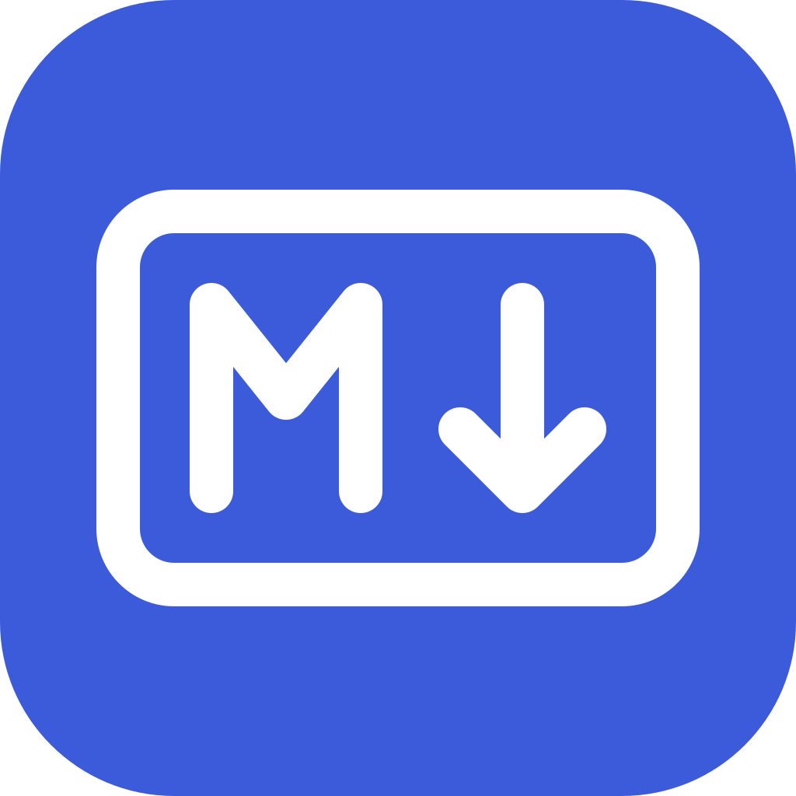
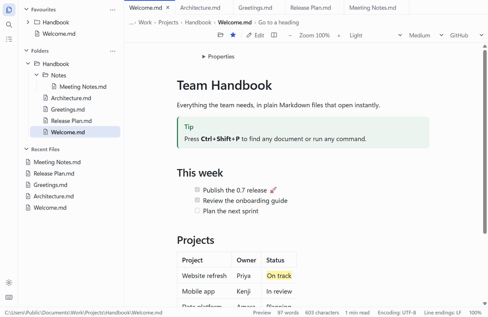
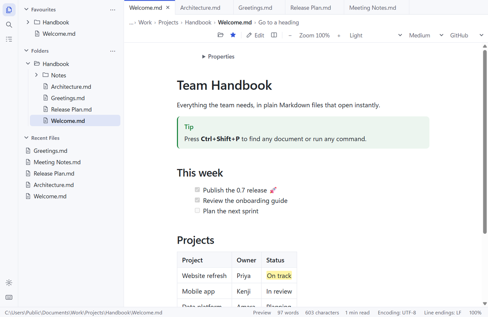
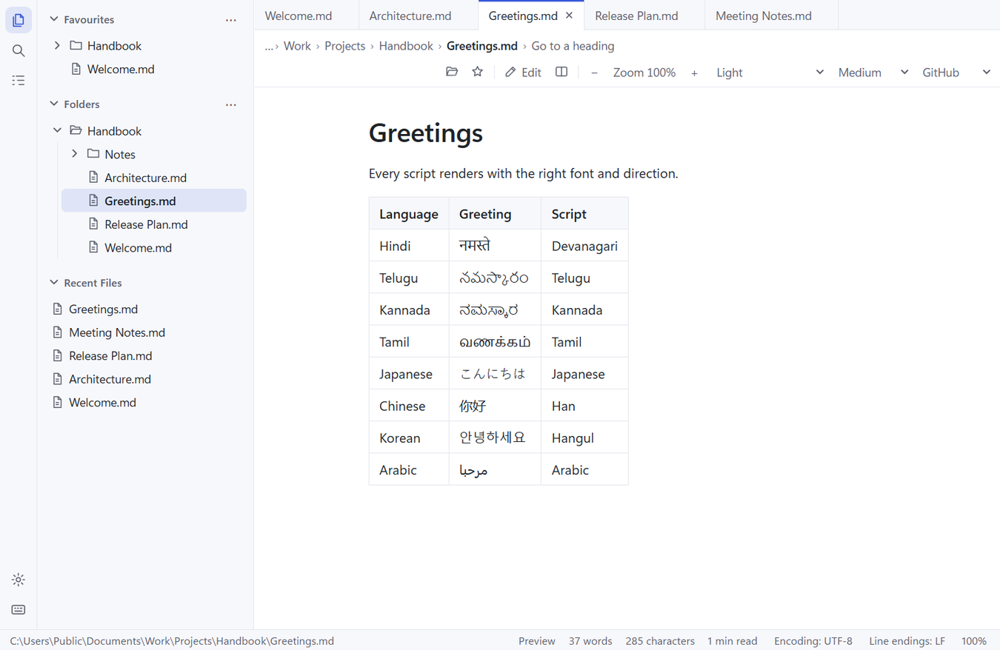

<p align="center">
  
</p>

<h1 align="center">MDX - Markdown Explorer<br><sub>The offline Markdown viewer for Windows</sub></h1>

<p align="center">
  A free, open-source Markdown viewer for Windows 10 and 11. Open your <code>.md</code> files in tabs, fully offline, with no telemetry and no account.
</p>

<!-- x-release-please-start-version -->
<p align="center">
  <a href="https://github.com/getaxtools/MDX/releases/download/v0.8.0/MDX-0.8.0-windows-x64-setup.exe"><strong>Download MDX 0.8.0 for Windows (x64)</strong></a> ·
  <a href="https://github.com/getaxtools/MDX/releases/download/v0.8.0/MDX-0.8.0-windows-arm64-setup.exe">Arm64</a> ·
  <a href="https://github.com/getaxtools/MDX/releases/tag/v0.8.0">Release notes</a>
</p>
<!-- x-release-please-end -->

<p align="center">
  <a href="https://github.com/getaxtools/MDX/releases/latest"></a>
  <a href="https://github.com/getaxtools/MDX/actions/workflows/ci.yml"></a>
  <a href="https://scorecard.dev/viewer/?uri=github.com/getaxtools/MDX"></a>
  <a href="#license"></a>
  
</p>

<!-- Language bar: add links here once translated READMEs exist at .github/readme/README.<lang>.md
     Example: English · 日本語 · 简体中文 · 한국어 · Português (Brasil) · Español · Русский · Deutsch -->

<p align="center">
  <a href="#features">Features</a> ·
  <a href="#download-and-install">Download</a> ·
  <a href="#your-data-stays-on-your-pc">Privacy</a> ·
  <a href="#keyboard-shortcuts">Shortcuts</a> ·
  <a href="#roadmap">Roadmap</a> ·
  <a href="#faq">FAQ</a> ·
  <a href="CONTRIBUTING.md">Contributing</a>
</p>

<p align="center">
  <picture>
    <source media="(prefers-reduced-motion: reduce)" srcset=".github/assets/screenshot-light.png">
    
  </picture>
</p>

Honestly, I made MDX because double-clicking a `.md` file on Windows opens Notepad. And Notepad shows you a mess of `#` signs and `|` pipes instead of headings and tables. I wanted something that opens the file right away, shows it the way GitHub does, and doesn't phone home. So I built it.

That's MDX. It reads GitHub-flavored Markdown, keeps your files in tabs, and remembers where you left off. You can edit files too, with a live preview right next to the editor. The menus and dialogs come in 16 languages. And the installer is under 6 MB, because MDX uses the WebView2 runtime that's already part of Windows instead of shipping its own browser engine.

It's built with [Tauri](https://tauri.app), Rust and Svelte.

> [!NOTE]
> MDX is still young (it hasn't reached 1.0 yet). It's ready to try, but expect some rough edges and changes between releases. [Bug reports](https://github.com/getaxtools/MDX/issues/new/choose) help a lot.

## Features

### Read Markdown the way GitHub shows it

Tables, task lists, strikethrough, autolinks and heading anchors all work like they do on GitHub. MDX also handles a bunch of extras: footnotes, alerts like `> [!NOTE]`, math (KaTeX), syntax highlighting in code blocks, emoji shortcodes, definition lists, abbreviations, highlighted text, and sub- and superscript. Front matter (the YAML block at the top of a file) shows up as a tidy properties panel.

- Pick a theme: light, dark, sepia, Solarized, Nord or high contrast. Or just follow Windows.
- Pick a text style: GitHub, a serif Book style, or Academic with numbered sections. Set the reading width and zoom (<kbd>Ctrl</kbd> + mouse wheel works too).
- An outline of headings lets you jump to any section, and back and forward work like a browser.
- When a file changes on disk, the view updates by itself.
- The status bar shows word count, reading time, encoding and line endings.
- Print, export to HTML or plain text, or copy a document as HTML.

### Keep your files close

- **Tabs that survive restarts.** Close MDX, open it tomorrow, and your tabs are back, including the one you were reading. You can pin tabs, drag them around and reopen one you closed by mistake.
- **Favourites.** Star a file with <kbd>Ctrl</kbd>+<kbd>D</kbd>. Sort favourites into groups, and export or import the list.
- **Recent files.** Your last 25 files, one click away.
- **Folders.** Open a whole folder in the side bar, search inside it with Find in Folders, or jump to any file by name from the command palette.
- **Works where your files live.** Local folders, network shares (`\\server\share`), mapped drives and OneDrive. Files load in the background, so a slow share won't freeze the window.
- **One window.** Double-click another `.md` file while MDX is open and it shows up as a new tab.

<p align="center">
  <picture>
    <source media="(prefers-color-scheme: dark)" srcset=".github/assets/screenshot-dark.png">
    <source media="(prefers-color-scheme: light)" srcset=".github/assets/screenshot-light.png">
    
  </picture>
</p>

### Edit when you need to

Press <kbd>Ctrl</kbd>+<kbd>/</kbd> to switch a document into editing. You get formatting keys (bold, italic, links, headings, lists), find and replace, and go to line. Turn on the preview beside the editor to see the result as you type. There's also Paste Table (<kbd>Ctrl</kbd>+<kbd>Alt</kbd>+<kbd>V</kbd>), which turns cells copied from Excel into a Markdown table. Kinda small, but super handy.

### Text in any script

Hindi, Telugu, Kannada, Tamil, Japanese, Chinese, Korean and Arabic all render correctly, including right-to-left text. MDX detects UTF-8, UTF-16 and older encodings like Shift_JIS. If it guesses wrong, use **File > Reopen with Encoding** (19 encodings to choose from).

The app itself is available in 16 languages: English, Arabic, Bengali, Chinese (Simplified), French, German, Hindi, Japanese, Kannada, Korean, Marathi, Portuguese (Brazil), Russian, Spanish, Tamil and Telugu. Change it in **Settings > Display Language**.

### Safe rendering

MDX treats every document as untrusted. Scripts, event handlers, iframes, remote images and dangerous links are removed before anything is shown. Clicking a link never navigates the app window away, and web links open in your browser only after you confirm. Math is typeset with KaTeX's `trust` option turned off.

<p align="center">
  <picture>
    <source media="(prefers-color-scheme: dark)" srcset=".github/assets/scripts-dark.png">
    <source media="(prefers-color-scheme: light)" srcset=".github/assets/scripts-light.png">
    
  </picture>
</p>

## Your data stays on your PC

- **No telemetry, analytics or crash uploads.** MDX doesn't collect anything about you or your documents.
- **No network connections.** The app never connects to the internet. Its [Content Security Policy](apps/desktop/src-tauri/tauri.conf.json) only allows local communication, and the window has [three narrow permissions](apps/desktop/src-tauri/capabilities/main-window.json).
- **No account.** There's nothing to sign up for.
- **Local storage only.** Tabs, favourites, recent files and settings are saved in `%APPDATA%\getaxtools\MDX` on your PC.

## Download and install

| Channel                                                       | Status        |
| ------------------------------------------------------------- | ------------- |
| [GitHub Releases](https://github.com/getaxtools/MDX/releases) | Available now |
| winget                                                        | Planned       |
| [Build from source](#build-from-source)                       | Available now |

<!-- x-release-please-start-version -->

1. Download the installer for your PC:
   - [MDX 0.8.0 for Windows x64](https://github.com/getaxtools/MDX/releases/download/v0.8.0/MDX-0.8.0-windows-x64-setup.exe) (most PCs)
   - [MDX 0.8.0 for Windows on Arm](https://github.com/getaxtools/MDX/releases/download/v0.8.0/MDX-0.8.0-windows-arm64-setup.exe) (Arm64 PCs, such as Snapdragon laptops)
2. Run it. It installs for your user account only, so you don't need admin rights.

<!-- x-release-please-end -->

Older versions and the checksum files are on the [releases page](https://github.com/getaxtools/MDX/releases).

Requirements: Windows 10 (22H2) or Windows 11, x64 or arm64, with the Microsoft Edge WebView2 Runtime. WebView2 is already included in Windows 11 and current Windows 10. If it's missing, the installer can download and install it.

The installer isn't code-signed yet (signing is planned), so Windows SmartScreen may show a warning. To check that a download is the real file, compare its SHA-256 hash with `SHA256SUMS.txt` on the release page, or verify its build provenance:

```powershell
gh attestation verify MDX-<version>-windows-x64-setup.exe --repo getaxtools/MDX
```

Each release also includes a CycloneDX software bill of materials (`.cdx.json`).

If MDX saves you some clicks, a ⭐ on GitHub helps other people find it.

## Keyboard shortcuts

Press <kbd>F1</kbd> in the app for the full list. The ones you'll use most:

| Action                              | Shortcut                                                                                      |
| ----------------------------------- | --------------------------------------------------------------------------------------------- |
| Open documents                      | <kbd>Ctrl</kbd>+<kbd>O</kbd>                                                                  |
| Command palette and quick open      | <kbd>Ctrl</kbd>+<kbd>Shift</kbd>+<kbd>P</kbd>                                                 |
| Find / find in folders              | <kbd>Ctrl</kbd>+<kbd>F</kbd> / <kbd>Ctrl</kbd>+<kbd>Shift</kbd>+<kbd>F</kbd>                  |
| Star or unstar the current document | <kbd>Ctrl</kbd>+<kbd>D</kbd>                                                                  |
| Switch between reading and editing  | <kbd>Ctrl</kbd>+<kbd>/</kbd>                                                                  |
| Preview beside the editor           | <kbd>Ctrl</kbd>+<kbd>\\</kbd>                                                                 |
| Source view                         | <kbd>Ctrl</kbd>+<kbd>U</kbd>                                                                  |
| Save                                | <kbd>Ctrl</kbd>+<kbd>S</kbd>                                                                  |
| Next / previous tab                 | <kbd>Ctrl</kbd>+<kbd>Tab</kbd> / <kbd>Ctrl</kbd>+<kbd>Shift</kbd>+<kbd>Tab</kbd>              |
| Go to tab 1-8 / last tab            | <kbd>Ctrl</kbd>+<kbd>1</kbd>…<kbd>8</kbd> / <kbd>Ctrl</kbd>+<kbd>9</kbd>                      |
| Close tab                           | <kbd>Ctrl</kbd>+<kbd>W</kbd> or middle-click                                                  |
| Reopen closed tab                   | <kbd>Ctrl</kbd>+<kbd>Shift</kbd>+<kbd>T</kbd>                                                 |
| Show or hide the side bar / outline | <kbd>Ctrl</kbd>+<kbd>Shift</kbd>+<kbd>E</kbd> / <kbd>Ctrl</kbd>+<kbd>Shift</kbd>+<kbd>O</kbd> |
| Zoom in / out / reset               | <kbd>Ctrl</kbd>+<kbd>+</kbd> / <kbd>Ctrl</kbd>+<kbd>-</kbd> / <kbd>Ctrl</kbd>+<kbd>0</kbd>    |
| Print                               | <kbd>Ctrl</kbd>+<kbd>P</kbd>                                                                  |
| Settings                            | <kbd>Ctrl</kbd>+<kbd>,</kbd>                                                                  |

## Roadmap

Planned, not available yet:

- A code-signed installer and a winget package
- Diagrams (Mermaid)
- A rich text editor, as well as the source editor
- Comparing two documents side by side
- Workspaces, plus highlights, comments and notes on documents
- Direct export to PDF
- macOS, Linux and a browser extension

Follow along in [issues](https://github.com/getaxtools/MDX/issues), and suggest ideas with the [feature request form](https://github.com/getaxtools/MDX/issues/new/choose).

## FAQ

### How do I open .md files on Windows?

Install MDX. It registers itself for `.md`, `.markdown`, `.mdown`, `.mkd` and `.mdx` files. If Windows still opens Notepad, right-click the file, choose **Open with > Choose another app**, pick MDX and set it as the default.

### Does MDX work offline?

Yes. It never connects to the internet, so a plane, a train or a locked-down office network is no big deal.

### Does it collect any data?

No. There's no telemetry, no analytics, no crash reporting and no account. See [Your data stays on your PC](#your-data-stays-on-your-pc).

### Can I edit Markdown files with it?

Yes. Press <kbd>Ctrl</kbd>+<kbd>/</kbd> to edit the current file in a source editor, with an optional live preview beside it. A rich text editor is on the [roadmap](#roadmap).

### Can it open files from a network share or OneDrive?

Yes. UNC paths like `\\server\share\notes.md`, mapped drives and OneDrive folders all work. If a location can't be reached, MDX shows a clear message instead of hanging.

### Is this related to the MDX format (JSX in Markdown)?

No, it's just the same letters (kinda confusing, I know). MDX - Markdown Explorer shows `.mdx` files as plain Markdown, and it never runs any code inside them.

### Is MDX free?

Yes. It's free and open source under the MIT or Apache-2.0 license, at your option.

## Build from source

Prerequisites:

- [Rust](https://rustup.rs) (the version in `rust-toolchain.toml`)
- [Node.js](https://nodejs.org) (the version in `.node-version`) with pnpm enabled: `corepack enable`
- [just](https://just.systems)
- The [Tauri prerequisites for Windows](https://v2.tauri.app/start/prerequisites/): Microsoft C++ Build Tools and WebView2

```powershell
git clone https://github.com/getaxtools/MDX.git
cd MDX
just setup   # install dependencies
just dev     # run the app
just build   # build the Windows installer
just check   # run every check CI runs
```

## Contributing

Contributions are welcome, including translation fixes from native speakers. Read [CONTRIBUTING.md](CONTRIBUTING.md) and [CODING-STANDARDS.md](CODING-STANDARDS.md) first, and open an issue before starting on a bigger feature so we can agree on scope. Every commit needs a [Developer Certificate of Origin](https://developercertificate.org) sign-off (`git commit -s`). Everyone taking part follows the [Code of Conduct](CODE_OF_CONDUCT.md). Please report security issues privately, as described in [SECURITY.md](SECURITY.md).

## License

Copyright (c) 2026 getaxtools.

Licensed under either of [Apache License, Version 2.0](LICENSE-APACHE) or [MIT license](LICENSE-MIT), at your option. Unless you explicitly state otherwise, any contribution you intentionally submit for inclusion in this project shall be dual-licensed as above, without any additional terms or conditions.
