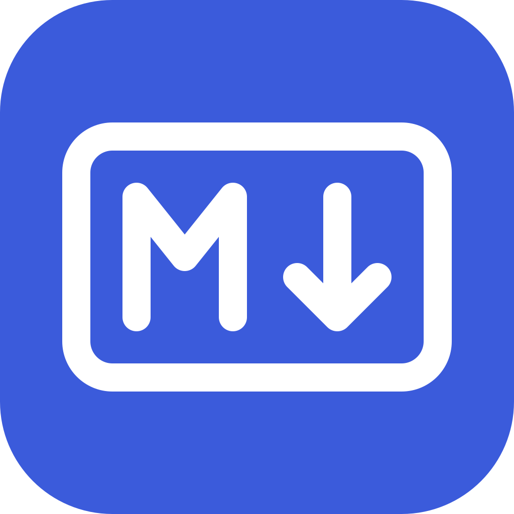
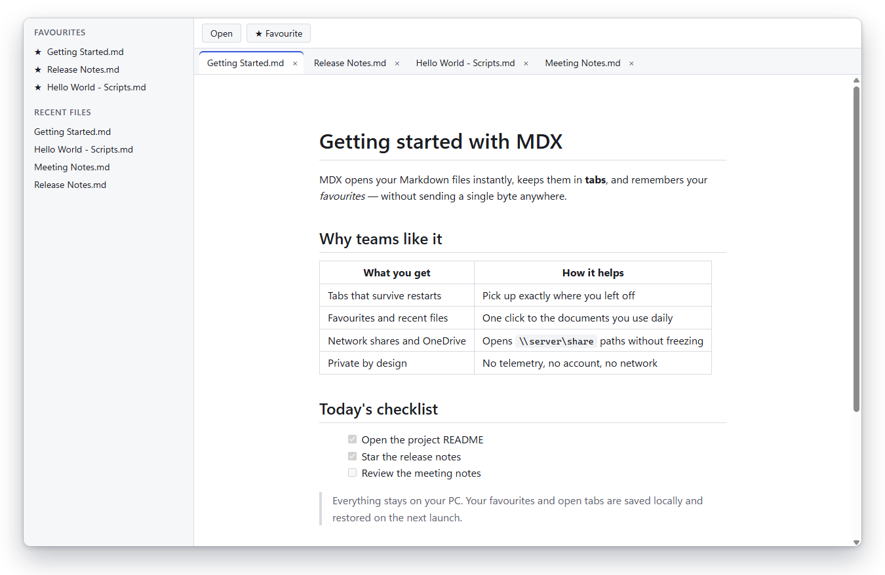
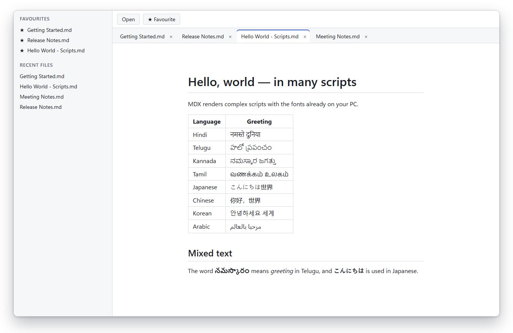

<p align="center">
  
</p>

<h1 align="center">MDX - Markdown Explorer</h1>

<p align="center">
  <strong>A fast, private Markdown viewer for Windows.</strong><br>
  Tabs, favourites and recent files for your <code>.md</code> documents. No telemetry, no account, no network.
</p>

<p align="center">
  <a href="https://github.com/getaxtools/MDX/actions/workflows/ci.yml"></a>
  <a href="https://scorecard.dev/viewer/?uri=github.com/getaxtools/MDX"></a>
  <a href="#license"></a>
  
</p>

<p align="center">
  <a href="#features">Features</a> ·
  <a href="#your-data-stays-on-your-pc">Privacy</a> ·
  <a href="#get-mdx">Get MDX</a> ·
  <a href="#roadmap">Roadmap</a> ·
  <a href="#faq">FAQ</a> ·
  <a href="CONTRIBUTING.md">Contributing</a>
</p>

<p align="center">
  <picture>
    <source media="(prefers-color-scheme: dark)" srcset=".github/assets/screenshot-dark.png">
    <source media="(prefers-color-scheme: light)" srcset=".github/assets/screenshot-light.png">
    
  </picture>
</p>

**MDX - Markdown Explorer** is a free, open-source **Markdown viewer for Windows 10 and Windows 11**. Open `.md` files from your PC, network shares or OneDrive folders, keep them in tabs, star the ones you use every day, and pick up exactly where you left off. It renders **GitHub-flavored Markdown** safely and displays every script, from Hindi, Telugu, Kannada and Tamil to Japanese, Chinese, Korean and Arabic. Built with [Tauri](https://tauri.app), Rust and Svelte, it uses the WebView2 runtime that already ships with Windows, so it stays small.

> [!NOTE]
> MDX is in early development. The first Windows release is being prepared; until then you can [build it from source](#build-from-source).

## Features

- **Tabs that survive restarts.** Open as many documents as you like. Your tabs and the active document come back the next time you start MDX.
- **Favourites.** Star a document with <kbd>Ctrl</kbd>+<kbd>D</kbd> and open it from the sidebar with one click.
- **Recent files.** The last 25 documents you opened, always one click away.
- **Open from anywhere.** Local folders, network shares (`\\server\share`), mapped drives and OneDrive folders. Files load in the background, so a slow share never freezes the window.
- **One window.** Double-click another `.md` file in Explorer while MDX is running and it opens as a new tab in the same window.
- **GitHub-flavored Markdown.** Tables, task lists, strikethrough, autolinks, heading anchors, and front matter kept out of the way.
- **Every script, every encoding.** Indic scripts, CJK and right-to-left text render correctly. UTF-8, UTF-16 and legacy encodings such as Shift_JIS are detected automatically.
- **Safe by design.** Documents are untrusted: scripts, event handlers, iframes, remote images and dangerous links are removed before anything is shown, and links never navigate the app away.
- **Light and dark.** MDX follows your Windows theme and respects reduced-motion settings.
- **Keyboard-friendly.** Familiar Windows shortcuts and full keyboard navigation of tabs.

<p align="center">
  <picture>
    <source media="(prefers-color-scheme: dark)" srcset=".github/assets/scripts-dark.png">
    <source media="(prefers-color-scheme: light)" srcset=".github/assets/scripts-light.png">
    
  </picture>
</p>

## Your data stays on your PC

- **No telemetry, analytics or crash uploads.** MDX doesn't collect anything about you or your documents.
- **No network connections.** The current version never connects to the internet. The app's [Content Security Policy](apps/desktop/src-tauri/tauri.conf.json) only allows local communication, and the window has [three narrow permissions](apps/desktop/src-tauri/capabilities/main-window.json).
- **No account.** Nothing to sign up for.
- **Local storage only.** Tabs, favourites and recent files are saved in `%APPDATA%\getaxtools\MDX` on your PC.

## Get MDX

| Channel                                                                                                  | Status                          |
| -------------------------------------------------------------------------------------------------------- | ------------------------------- |
| [GitHub Releases](https://github.com/getaxtools/MDX/releases) (signed installer, no admin rights needed) | Coming with the first release   |
| winget                                                                                                   | Planned after the first release |
| [Build from source](#build-from-source)                                                                  | Available now                   |

Requirements: Windows 10 (22H2) or Windows 11, x64 or arm64, with the Microsoft Edge WebView2 Runtime (included in Windows 11 and current Windows 10).

## Keyboard shortcuts

| Action                              | Shortcut                                                                         |
| ----------------------------------- | -------------------------------------------------------------------------------- |
| Open documents                      | <kbd>Ctrl</kbd>+<kbd>O</kbd>                                                     |
| Star or unstar the current document | <kbd>Ctrl</kbd>+<kbd>D</kbd>                                                     |
| Next / previous tab                 | <kbd>Ctrl</kbd>+<kbd>Tab</kbd> / <kbd>Ctrl</kbd>+<kbd>Shift</kbd>+<kbd>Tab</kbd> |
| Go to tab 1-8 / last tab            | <kbd>Ctrl</kbd>+<kbd>1</kbd>…<kbd>8</kbd> / <kbd>Ctrl</kbd>+<kbd>9</kbd>         |
| Close tab                           | <kbd>Ctrl</kbd>+<kbd>W</kbd> or middle-click                                     |
| Reopen closed tab                   | <kbd>Ctrl</kbd>+<kbd>Shift</kbd>+<kbd>T</kbd>                                    |

## Roadmap

Planned, not yet available:

- Menus, About dialog, zoom, reading width and find in page
- Live reload when a file changes on disk
- Syntax highlighting, diagrams (Mermaid) and math (KaTeX)
- Editing with a rich text editor, side-by-side documents and file compare
- Workspaces, highlights, comments and notes per document
- Print and export to PDF
- 16 interface languages, including Hindi, Telugu, Kannada and Tamil
- macOS, Linux and a browser extension

Follow progress in [issues](https://github.com/getaxtools/MDX/issues) and suggest features with the feature request form.

## FAQ

### Is MDX related to the MDX format (JSX in Markdown)?

No. MDX - Markdown Explorer is a viewer for plain Markdown. Files with the `.mdx` extension are shown as Markdown text; embedded code is never executed.

### Is it free?

Yes. MDX is free and open source under the MIT or Apache-2.0 license, at your option.

### Does it work offline?

Yes. MDX never needs the internet.

### Can I open files from network shares and OneDrive?

Yes. Use UNC paths such as `\\server\share\notes.md`, mapped drives or OneDrive folders. Unreachable locations show a clear message instead of freezing the window.

### Can I edit documents?

Not yet. MDX is a viewer today; editing is on the [roadmap](#roadmap).

### Will there be macOS and Linux versions?

Yes, they are planned. The app is built with Tauri so the same code can run on all three platforms.

## Build from source

Prerequisites:

- [Rust](https://rustup.rs) (the version in `rust-toolchain.toml`)
- [Node.js](https://nodejs.org) (the version in `.node-version`) with pnpm enabled: `corepack enable`
- [just](https://just.systems)
- The [Tauri prerequisites for Windows](https://v2.tauri.app/start/prerequisites/): Microsoft C++ Build Tools and WebView2

```powershell
git clone https://github.com/getaxtools/MDX.git
cd MDX
just setup   # install dependencies
just dev     # run the app
just check   # run every check CI runs
```

## Contributing

Contributions are welcome. Read [CONTRIBUTING.md](CONTRIBUTING.md) and [CODING-STANDARDS.md](CODING-STANDARDS.md) first. Everyone taking part follows the [Code of Conduct](CODE_OF_CONDUCT.md). Report security issues privately as described in [SECURITY.md](SECURITY.md).

Every release is planned to ship code-signed, with `SHA256SUMS.txt`, a software bill of materials and build provenance, so you can verify what you install.

## License

Copyright (c) 2026 getaxtools.

Licensed under either of [Apache License, Version 2.0](LICENSE-APACHE) or [MIT license](LICENSE-MIT), at your option. Unless you explicitly state otherwise, any contribution you intentionally submit for inclusion in this project shall be dual-licensed as above, without any additional terms or conditions.

---

<p align="center">If MDX is useful to you, a ⭐ on GitHub helps other people find it.</p>
