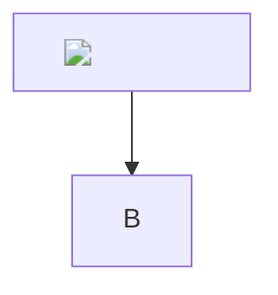

# Math

Inline links and HTML in math: $\href{javascript:alert(1)}{click}$ and $\url{javascript:alert(2)}$.

Raw HTML pretending to be math: x

Markup inside math: $$ and $$$$

$$
\htmlStyle{background:url(https://example.com/track.png)}{x}
\includegraphics{https://example.com/track.png}
$$

Expansion bomb: $\def\a{\a\a}\a$

<pre class="mdx-mermaid"><code>graph TD; A-->B</code></pre>
